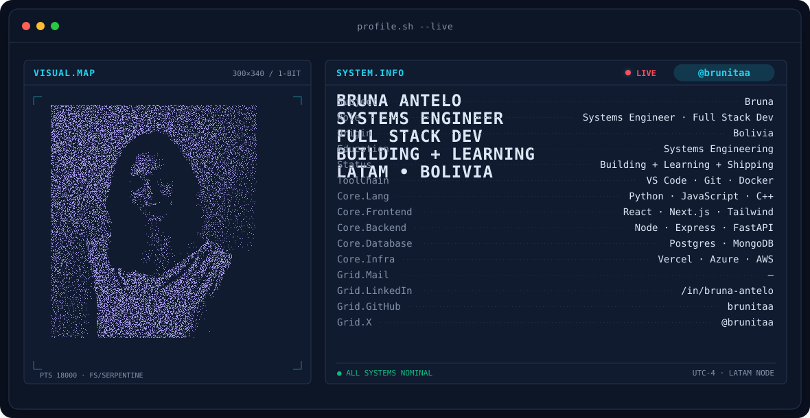

<!-- PROFILE BANNER -->

<picture>
  <source media="(prefers-color-scheme: dark)" srcset="assets/banner-dark.v9.svg">
  <source media="(prefers-color-scheme: light)" srcset="assets/banner-light.v9.svg">
  
</picture>

  

&nbsp;

  

---

## About me

Hi, I'm **Bruna**, a Systems Engineering graduate from Bolivia 🇧🇴 with a strong interest in building software that is useful, thoughtful, and impactful.

I enjoy turning ideas into practical solutions, learning by doing, and collaborating with people who care about technology as a tool for real change. My work focuses on web development, backend systems, and creating products that balance usability with solid engineering.

- 💻 **Software engineering:** Web, backend, and product-oriented development.
- 🤖 **AI & experimentation:** Exploring how intelligent tools can enhance real-world experiences.
- 🌱 **Growth mindset:** Learning continuously, improving my craft, and shipping meaningful work.
- 🌟 **Community leadership:** Supporting inclusion, learning, and participation in tech.
- 💬 **Open to:** software projects, collaboration, and conversations around technology with purpose.

 

## Tech stack

---

## Selected projects

<table>
<tr>
<td width="50%" valign="top">

### CAA-Backend

[Repository](https://github.com/brunitaa/CAA-Backend)

**About the project**

Backend-focused project designed to improve maintainability, structure application logic, and support cleaner data flows in a real use case.

**Technologies:** Python, backend APIs, databases, and service architecture.

</td>
<td width="50%" valign="top">

### MAGEO

[Repository](https://github.com/brunitaa/MAGEO)

**About the project**

A practical project centered on discovery and user experience, helping people access relevant information in a clearer and more useful way.

**Technologies:** JavaScript, frontend development, and application logic.

</td>
</tr>
<tr>
<td width="50%" valign="top">

### ParkFinderWEB

[Repository](https://github.com/brunitaa/ParkFinderWEB)

**About the project**

A web application focused on making everyday decisions easier by improving access to useful parking information.

**Technologies:** HTML, CSS, JavaScript, and frontend development.

</td>
<td width="50%" valign="top">

### webISI

[Repository](https://github.com/brunitaa/webISI)

**About the project**

A project focused on web interfaces, structured information flow, and building a user-friendly digital experience.

**Technologies:** Frontend development, web architecture, and UI design.

</td>
</tr>
</table>

---

## Communities & leadership

- **Women Techmakers** — Ambassador
- **Microsoft User Group Bolivia** — Technology community
- **PyLadies Santa Cruz de la Sierra** — Python community

I believe communities are one of the best places to grow, learn, and build with purpose. I enjoy creating spaces where people can connect, share knowledge, and support each other.

---

## GitHub stats

---

### Let’s connect

  

Built with curiosity, learning, and a love for technology · @brunitaa

