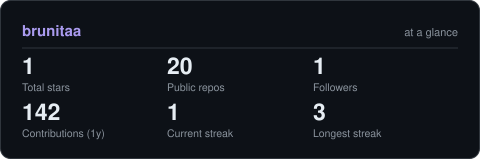
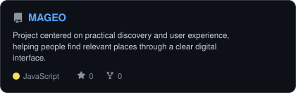
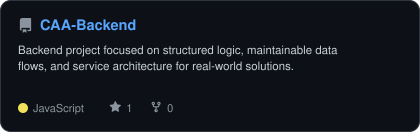
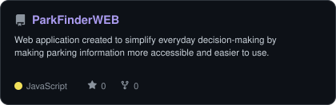
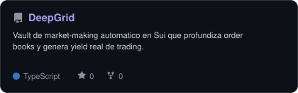

 

<picture>
  <source media="(prefers-color-scheme: dark)" srcset="assets/banner-dark.v9.svg">
  <source media="(prefers-color-scheme: light)" srcset="assets/banner-light.v9.svg">
  
</picture>

 

&nbsp;

&nbsp;

  

---

## About me

Hi, I'm **Bruna** — a Systems Engineering graduate from Bolivia 🇧🇴 who loves exploring ideas, building things, and discovering how technology can make a real difference in people's lives.

For me, software development is more than writing code. It's about understanding the people behind a problem, asking the right questions, and turning ideas into solutions that are actually useful. That's what motivates me to keep learning, experiment with new technologies, and build projects with purpose.

- 💻 **Building:** Web applications, backend systems, and ideas that turn into real projects.
- 💜 **Purpose-driven tech:** Especially projects that address overlooked problems and make technology more accessible.
- 🌱 **Always curious:** Learning by doing, exploring new tools, and getting a little better with every project.
- 🤝 **Community & connection:** Sharing knowledge, collaborating, and helping create spaces where more people feel they belong in tech.
- ✨ **Beyond the code:** I care about the _why_ behind what we build just as much as the _how_.

I believe the best things happen when curiosity meets empathy — and that's the kind of developer, teammate, and community builder I'm working to become.

 

## Tech stack

---

## Professional snapshot

<picture>
  <source media="(prefers-color-scheme: dark)" srcset="assets/card-stats-dark.svg">
  <source media="(prefers-color-scheme: light)" srcset="assets/card-stats-light.svg">
  
</picture>

---

## Skills radar

<table>
<tr>
<td align="center" width="50%">
<picture>
  <source media="(prefers-color-scheme: dark)" srcset="assets/radar-dark.svg">
  <source media="(prefers-color-scheme: light)" srcset="assets/radar-light.svg">
  
</picture>
</td>
<td align="center" width="50%">
<picture>
  <source media="(prefers-color-scheme: dark)" srcset="assets/radar-langs-dark.svg">
  <source media="(prefers-color-scheme: light)" srcset="assets/radar-langs-light.svg">
  
</picture>
</td>
</tr>
</table>

---

## Featured projects

<table>
<tr>
<td width="50%" valign="top">
<picture>
  <source media="(prefers-color-scheme: dark)" srcset="assets/card-MAGEO-dark.svg">
  <source media="(prefers-color-scheme: light)" srcset="assets/card-MAGEO-light.svg">
  
</picture>
</td>
<td width="50%" valign="top">
<picture>
  <source media="(prefers-color-scheme: dark)" srcset="assets/card-CAA-Backend-dark.svg">
  <source media="(prefers-color-scheme: light)" srcset="assets/card-CAA-Backend-light.svg">
  
</picture>
</td>
</tr>
<tr>
<td width="50%" valign="top">
<picture>
  <source media="(prefers-color-scheme: dark)" srcset="assets/card-ParkFinderWEB-dark.svg">
  <source media="(prefers-color-scheme: light)" srcset="assets/card-ParkFinderWEB-light.svg">
  
</picture>
</td>
<td width="50%" valign="top">
<picture>
  <source media="(prefers-color-scheme: dark)" srcset="assets/card-DeepGrid-dark.svg">
  <source media="(prefers-color-scheme: light)" srcset="assets/card-DeepGrid-light.svg">
  
</picture>
</td>
</tr>
</table>

---

## Communities & leadership

- **Women Techmakers** — Ambassador
- **Microsoft User Group Bolivia** — Technology community
- **PyLadies Santa Cruz de la Sierra** — Python community

I believe communities are one of the best places to grow, learn, and build with purpose. I enjoy creating spaces where people can connect, share knowledge, support each other, and make technology more accessible.

---

### Let's connect

  

Built with curiosity, learning, and a love for technology · @brunitaa

