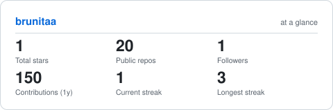
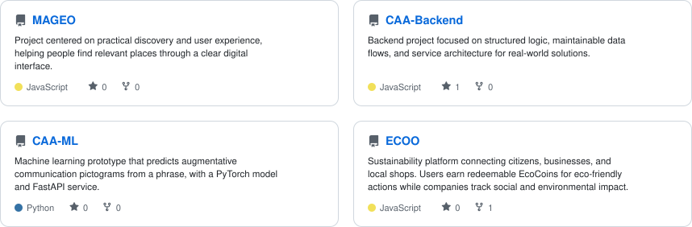

<picture>
  <source media="(prefers-color-scheme: dark)" srcset="assets/waves-dark.gif">
  
</picture>

<h1>Bruna Antelo Prado</h1>
<h3>Systems Engineer • Data Analyst • AI &amp; Programming Mentor</h3>

  Bolivia 🇧🇴 · Turning data into clear insights and useful solutions.

&nbsp;

&nbsp;

  

---

## About

I am a Systems Engineer and Data Analyst who enjoys turning data into clear information that supports better decisions. I am interested in business intelligence, practical technology, and helping others learn programming and artificial intelligence.

- **Data analysis:** working with data to answer questions and surface useful insights.
- **Business intelligence:** creating clear reports and dashboards with Qlik and Power BI.
- **Querying:** using SQL to explore and work with data.
- **Mentoring:** supporting people who are learning programming and AI.

---

## Metrics

<picture>
  <source media="(prefers-color-scheme: dark)" srcset="assets/card-stats-dark.svg">
  
</picture>

---

## Data &amp; Analytics

**Areas of interest:** data analysis · business intelligence · dashboards · data querying

---

## Projects

<picture>
  <source media="(prefers-color-scheme: dark)" srcset="assets/projects-grid-dark.svg">
  
</picture>

---

## Community

- **Women Techmakers** — Community ambassador
- **PyLadies Santa Cruz de la Sierra** — Supporting women in Python and technology
- **Nos gusta la ciencia de programación IA** — Mentor

I value technology that is useful, collaborative, and accessible to others.

---

### Let’s connect

  

Data with purpose · learning together · @brunitaa

